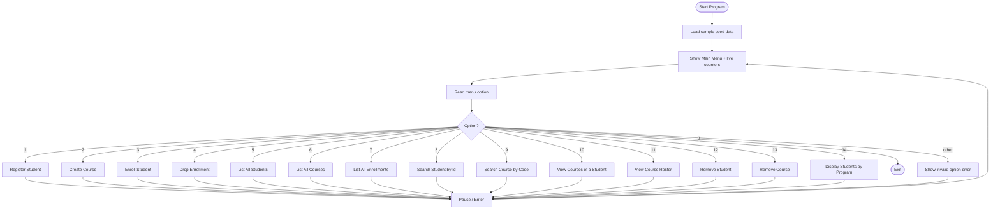
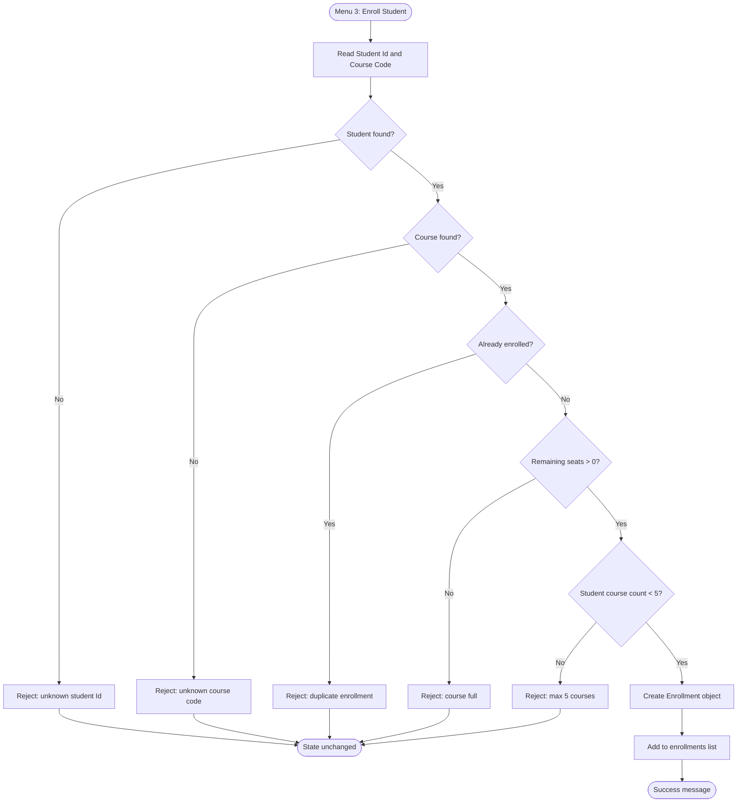
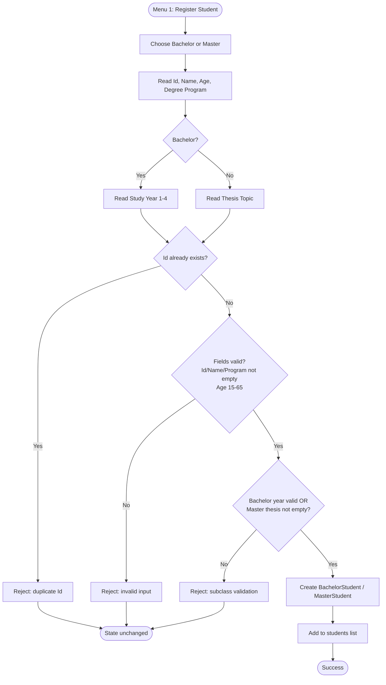

# Application Flowcharts — 01. Student Management System

These flowcharts match the implemented console application and can be rendered with any Mermaid viewer (VS Code, GitHub, [mermaid.live](https://mermaid.live)). Export screenshots into the Word report if required.

---

## 1. Main menu control flow

---

## 2. Enroll Student decision flow (core business rules)

---

## 3. Register Student validation flow

---

## How this satisfies the brief

- Shows class-operation behavior as a functional console workflow
- Makes success vs rejection paths explicit for testing and oral defense
- Complements the UML class diagram (structure) with runtime process flow (behavior)
