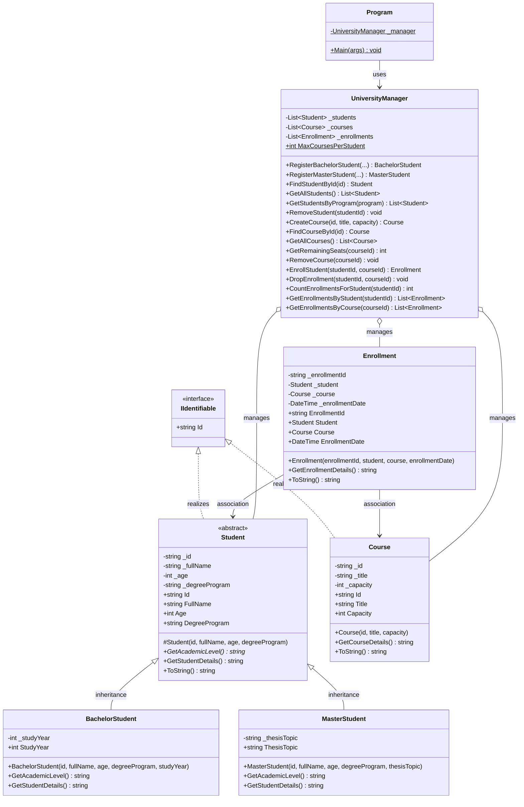

# UML Class Diagram — 01. Student Management System

The diagram below matches the implemented C# solution. Render it in any Mermaid-compatible viewer (GitHub, VS Code Mermaid extension, mermaid.live), then export/screenshot for the PDF report if needed.

## Diagram

## Relationships and multiplicities

| Relationship | Type | Multiplicity | Meaning |
|--------------|------|--------------|---------|
| `BachelorStudent` / `MasterStudent` → `Student` | Inheritance | 1 | Specialized student kinds reuse common fields |
| `Student` / `Course` → `IIdentifiable` | Realization | 1 | Shared read-only `Id` contract |
| `Enrollment` → `Student` | Association | many enrollments : 1 student | A student may have 0..5 enrollments |
| `Enrollment` → `Course` | Association | many enrollments : 1 course | A course may have 0..Capacity enrollments |
| `UniversityManager` → collections | Composition-like ownership | 1 manager owns many records | In-memory registry; UI never mutates lists directly |
| `Program` → `UniversityManager` | Dependency / use | 1 | Console UI delegates all business rules |

## Consistency with code

- Abstract `Student` + overrides in `BachelorStudent` / `MasterStudent` → polymorphism
- Private fields + validated properties → encapsulation
- `Enrollment` stores object references (not only IDs) → association / composition-style link object
- `UniversityManager` concentrates CRUD and rejection rules → clear class responsibility separation from UI
