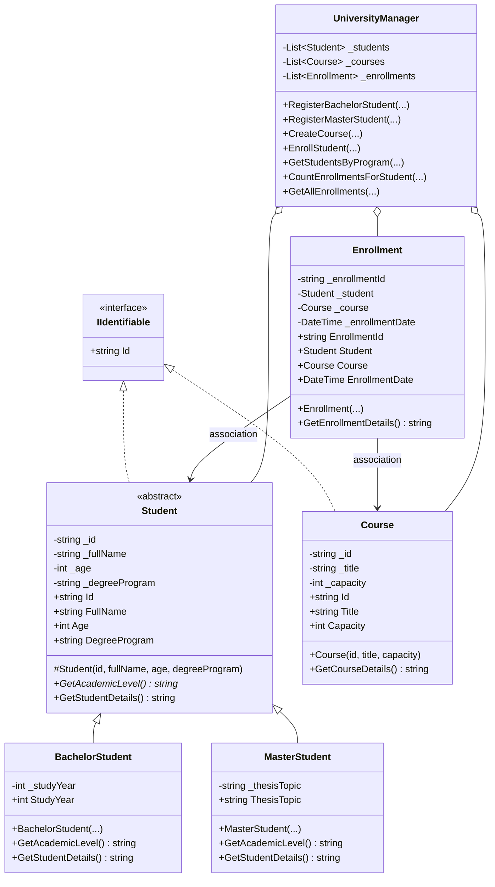

# UML Class Diagram — 01. Student Management System

Matches the implemented C# code. View in VS Code Mermaid preview or https://mermaid.live

## Relationships

| Relationship | Type | Meaning |
|--------------|------|---------|
| Bachelor/Master → Student | Inheritance | Specialized student types |
| Student/Course → IIdentifiable | Interface | Shared Id contract |
| Enrollment → Student/Course | Association | One enrollment links one student to one course |
| UniversityManager → lists | Ownership | In-memory registry for CRUD and rules |
